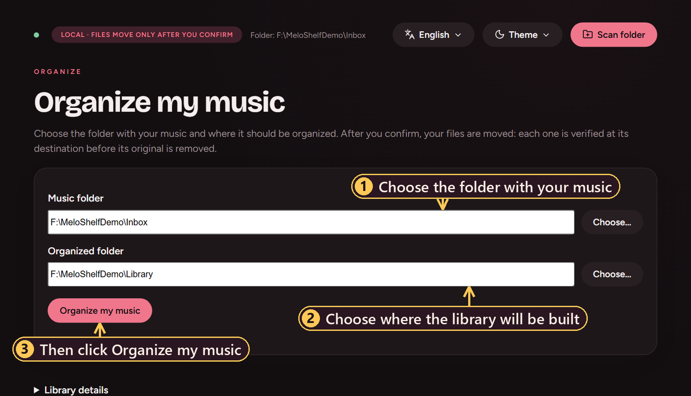
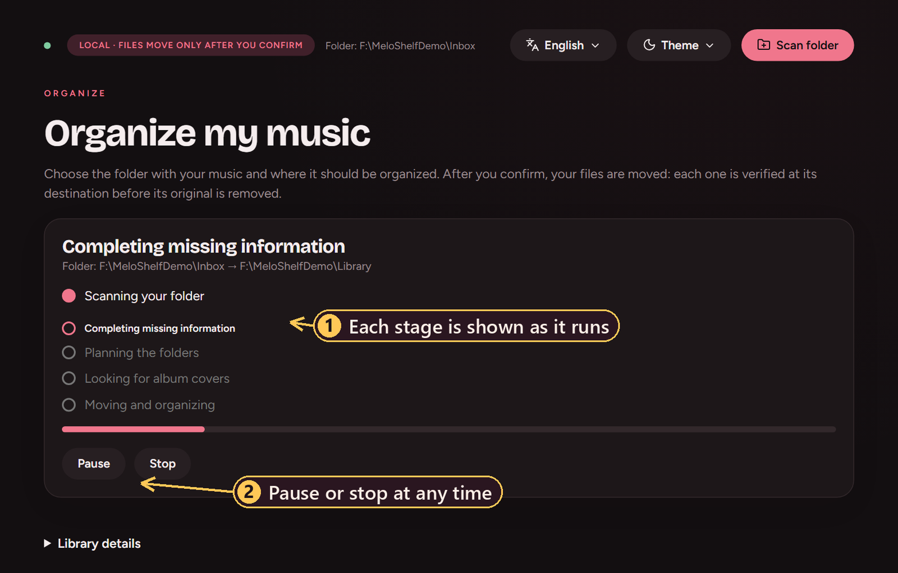
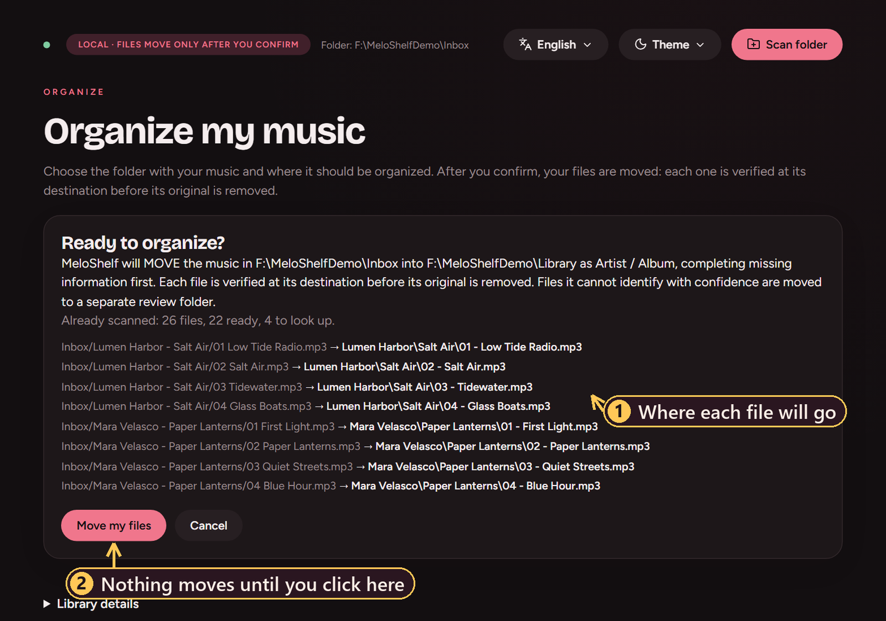
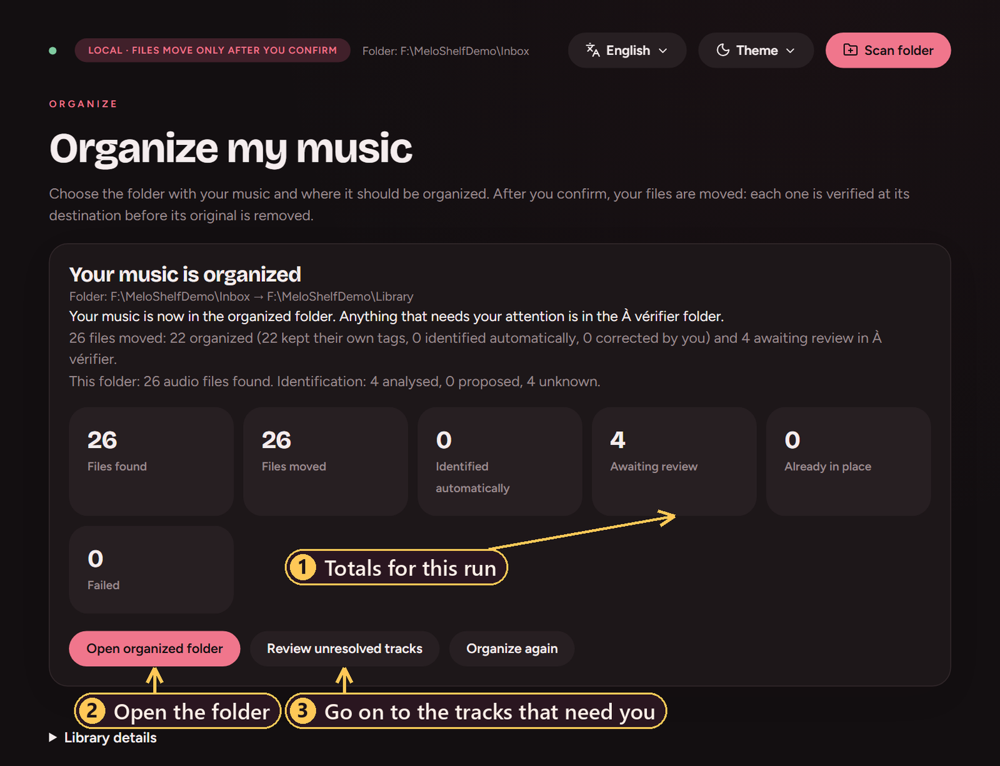
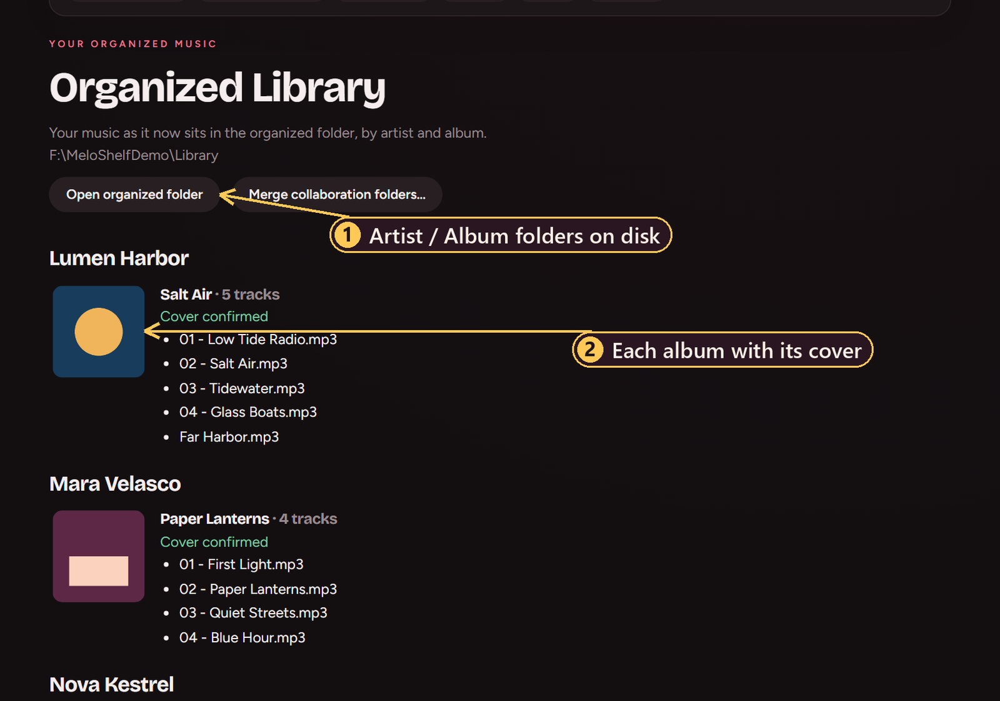
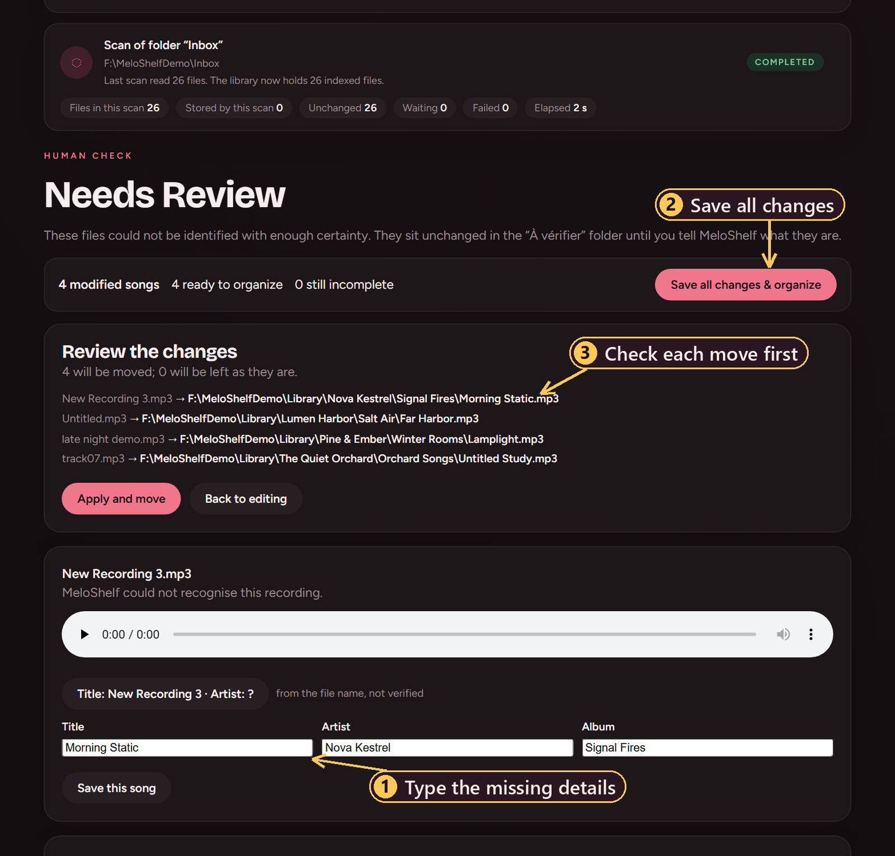
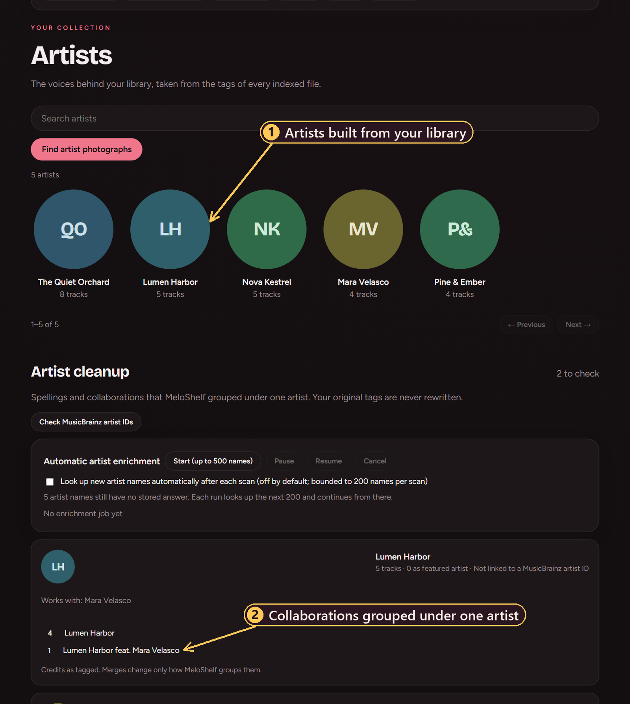

<p align="center">
  
</p>

<h1 align="center">MeloShelf</h1>

<p align="center">A local-first Windows music organizer that identifies tracks, completes missing metadata,<br>
sorts audio files into Artist and Album folders, and sets uncertain recordings aside for you to review.</p>

<p align="center">
  
</p>

MeloShelf takes a folder of mixed music and a destination folder. Files whose tags are reliable keep their own
metadata. Files with missing or doubtful tags are identified from their sound. Every file is then moved to
`Artist/Album/NN - Title.ext`. Anything MeloShelf cannot identify with confidence goes to a separate review folder
and is listed in the app, where you can fill in the details and send it to the right place.

It runs on your own computer. The interface opens in your web browser and is served only to your machine
(`127.0.0.1`). Your audio is never uploaded.

## Key features

- **Safe moves.** Nothing moves until you confirm a preview. Each file is copied or renamed to a temporary name,
  verified with SHA-256, published, and only then is the original removed. If anything cannot be verified, the original stays.
- **Crash recovery.** Every step is written to a journal. If the app or the computer stops in the middle of a move,
  the next run settles the interrupted file first, so nothing is lost or duplicated.
- **Identification by sound.** Chromaprint fingerprints are looked up on AcoustID and enriched from MusicBrainz.
  Results are ranked on evidence and are never presented as certain.
- **Human review.** Unresolved tracks are listed with an audio player and any suggested candidates. You correct many songs
  at once and apply them with **Save all changes**.
- **Album covers and artist photographs.** Covers come from your own files, MusicBrainz and the Cover Art Archive.
  Artist photographs come from Wikimedia Commons with attribution. Each image is labelled by how sure MeloShelf is.
  When nothing trustworthy is found, MeloShelf says so instead of guessing.
- **One folder per primary artist.** `Artist feat. Guest` and `Artist & Guest` are filed under `Artist`, while real group
  names such as `Simon & Garfunkel` are kept whole.
- **Eight interface languages** (English plus seven machine-drafted translations).

## Download and installation

**Supported platform:** Windows 10 or 11, 64-bit. macOS and Linux have not been tested.

**Windows installer.** A per-user installer (no administrator rights, no Python needed) and a portable ZIP can be built
from this repository with `packaging\build.ps1` (see [Build from source](#build-from-source)). Ready-made binaries are not
published yet. The project does not have a licence yet, and the build contains a GPL component (see
[License and third-party acknowledgements](#license-and-third-party-acknowledgements)), so binaries will be released
once that is settled. The installer is not code-signed, so Windows SmartScreen will show a warning the first time it is run.
Choose **More info**, then **Run anyway**.

**From source.** You need Python 3.11 or newer.

```powershell
git clone https://github.com/Danieljucke/MeloShelf.git
cd MeloShelf
python -m venv .venv
.\.venv\Scripts\python.exe -m pip install -e .
.\.venv\Scripts\python.exe -m meloshelf
```

MeloShelf prints its address and opens it in your browser.

## Quick start

1. Start MeloShelf. The Home screen opens in your browser.
2. Choose the music folder and the folder where the organized library should be built.
3. Click **Organize my music**, read the preview, then click **Move my files**.
4. Open **Needs Review** for any track that could not be identified.

Identification by sound needs Chromaprint (`fpcalc`) and a free AcoustID key. Without them, MeloShelf still organizes
music with reliable tags and sends the rest to review. Setup is described in step 2 of the guide.

## Step-by-step guide

MeloShelf **moves** your files after you confirm. It does not leave a second copy behind. Keep a backup of anything
irreplaceable before you organize it for the first time.

### 1. Install and launch

Run the installer and start **MeloShelf** from the Start menu, or run `python -m meloshelf` from source. A small window
with **Open MeloShelf** and **Quit** appears and the interface opens in your browser. Starting MeloShelf a second time
reopens the running instance instead of starting another.

### 2. Set up fpcalc and the optional recognition services

This step is only needed for recognition by sound. You can skip it and come back later.

1. **Chromaprint (`fpcalc`).** Download the Windows command-line build from <https://acoustid.org/chromaprint> and extract it,
   for example to `C:\Tools\chromaprint`. MeloShelf finds it on your `PATH`, in common folders such as `C:\Tools\chromaprint`
   and `%LOCALAPPDATA%\chromaprint`, or at the path you enter in **Settings**. MeloShelf does not download or bundle it.
   After installing it, click **Check again** on the Home screen. No restart is needed.
2. **AcoustID key.** Create a free application key at <https://acoustid.org/new-application> and paste it into
   **Settings, Identification services**. It is stored in the Windows Credential Manager and is not shown again.
3. **MusicBrainz contact (optional).** MusicBrainz asks applications to identify themselves. Enter a contact in Settings.
   Without it, MeloShelf skips release enrichment instead of sending anonymous requests.

Each row in Settings has a **Test** button.

### 3. Choose the source folder

On Home, type the path of the folder that holds your music or click **Choose**. MeloShelf reads
`.mp3 .flac .m4a .aac .ogg .opus .wav .aiff .aif` files in that folder and its subfolders. Symbolic links are skipped.

### 4. Choose the destination folder

Choose where the organized library should be built. The destination cannot be inside the music folder, and the music
folder cannot be inside the destination, so organized output is never scanned again as source. If the destination is on
another drive, MeloShelf says so and checks the free space before it starts.

<p align="center">
  
</p>

### 5. Scan and identify

Click **Organize my music**. MeloShelf scans the folder without changing anything, then shows a preview. Once you
confirm, it reports each stage separately: scanning, completing missing information, planning folders, looking for album
covers, and moving. **Pause** and **Stop** are available while it runs.

<p align="center">
  
</p>

A file keeps its own tags when it has a real title and artist and the tags do not contradict its file name. Files with
numeric or generic names, or missing or conflicting tags, are identified by sound when fpcalc and an AcoustID key are set up.

### 6. Preview and confirm

The preview lists where each file will go. Nothing has moved yet. Click **Move my files** to start, or **Cancel**.

<p align="center">
  
</p>

When the run ends, the result screen lists the files found, moved, identified automatically, awaiting review,
already in place and failed.

<p align="center">
  
</p>

### 7. Open the organized Artist and Album folders

Click **Open organized folder**, or open **Organized Library** to browse the result inside MeloShelf.

<p align="center">
  
</p>

### 8. Correct unidentified tracks with Needs Review and Save all

Tracks that could not be identified were moved, with their original names, to a folder named `À vérifier` inside the
destination. The folder name is fixed and in French. **Needs Review** lists each of them with a player. Type the title,
artist and album, or pick a suggested candidate. The edits are kept as drafts, so you can move between screens or reload
the page. Then click **Save all changes and organize**, check the preview, and confirm with **Apply and move**.
A title and an artist are required. The album may stay empty. A decision you made earlier is never replaced without
your confirmation.

<p align="center">
  
</p>

### 9. Browse canonical artists, albums, photographs and covers

The **Artists** view shows one entry per primary artist. Open an artist to see the albums, covers, collaborations and the
original credit of each song. **Find artist photographs** and **Find album covers** fetch images and label each as
confirmed, suggested or missing. Artists without a photograph show their initials. Under **Organized Library**, **Merge
collaboration folders** can tidy folders that an earlier run created for credits such as `Artist & Guest`. It shows a dry
run first and offers an undo.

<p align="center">
  
</p>

The screenshots use disposable demonstration files with invented artist names. The demo audio is silent.

## Example organized folder

```
Library/
  Lumen Harbor/
    Salt Air/
      01 - Low Tide Radio.mp3
      02 - Salt Air.mp3
      03 - Tidewater.mp3        (credited "Lumen Harbor feat. Mara Velasco", filed under Lumen Harbor)
  The Quiet Orchard/
    Late Bloom/
      01 - Windfall.mp3
  À vérifier/
    track07.mp3                  (waiting in Needs Review)
```

## Music recognition and artwork sources

| Source | Used for | Needs |
| --- | --- | --- |
| Chromaprint (`fpcalc`) | Audio fingerprint, computed on your machine | Installed by you |
| AcoustID | Matching a fingerprint to recordings. Only the fingerprint and the duration are sent. | Your own free key |
| MusicBrainz | Recording, release and artist details | Optional contact |
| Cover Art Archive | Album covers for releases MusicBrainz identified | None |
| Wikimedia Commons | Artist photographs with licence and author | None |
| Fanart.tv (optional) | Fallback artist and album images | Your own key |
| TheAudioDB (optional) | Fallback images | A premium key. Not tested. |

Only a cover that MeloShelf can confirm is written into your files. A cover you accept from a catalogue is stored as your
choice together with its source. Images from optional providers are display-only and are never embedded. Accepting one
records your choice, but it is not proof that the provider allows reuse. Read each provider's terms
(<https://fanart.tv/api-docs/api-v3/>, <https://www.theaudiodb.com/free_music_api>) before relying on those images. The Fanart.tv
terms could not be checked automatically when this was written.

Recognition quality depends on what AcoustID and MusicBrainz return. Many songs do not match with enough confidence and are
sent to review. MeloShelf does not claim a recognition accuracy figure.

## Data safety and crash recovery

- **Moves are verified.** On one drive a file is renamed to a temporary name next to its destination. Across drives it is
  transferred to a temporary name, flushed and compared by size and SHA-256. The original is removed only after the
  destination matches the journal and the original still has its recorded hash.
- **Nothing is overwritten.** A name collision gets ` (2)`, ` (3)` and so on. A locked or read-only original stays where it
  is and the reason is recorded.
- **Interruptions are safe.** If MeloShelf is stopped mid-move, the next run settles the interrupted file before planning,
  so no file is duplicated or lost. A run that stopped shows **Resume** on the Home screen. Closing the control window
  while a move is running asks for confirmation first.
- **No delete mode.** MeloShelf never deletes music.
- **Your data stays local.** The library database is `%USERPROFILE%\.meloshelf\library.sqlite3` and logs are in
  `%LOCALAPPDATA%\MeloShelf`. Uninstalling keeps both and never touches your music. API keys are kept in the Windows
  Credential Manager. The local service listens on `127.0.0.1` only and checks the `Host` and `Origin` headers, and
  state-changing requests need a per-session token.

## Advanced configuration

| Setting | Environment variable | Default |
| --- | --- | --- |
| AcoustID key | `MELOSHELF_ACOUSTID_KEY` | Credential store, then the variable |
| MusicBrainz contact | `MELOSHELF_MUSICBRAINZ_USER_AGENT` | None |
| Chromaprint location | `MELOSHELF_FPCALC` | Search the `PATH` and common folders |

A value saved in MeloShelf takes precedence over the environment variable. Command-line options:

| Option | Effect |
| --- | --- |
| `--no-browser` | Do not open a browser |
| `--port N` | Use a fixed loopback port |
| `--db PATH` | Use another library file |

Automatic approval of a recognized recording needs a score of at least 80 by default (adjustable from 50 to 100), one
independent matching signal, and no contradicting tag or duration. It confirms the recording only and never chooses an album
edition. The score is a ranking heuristic, not a probability.

## Build from source

```powershell
python -m venv .venv
.\.venv\Scripts\python.exe -m pip install -e ".[dev]"
.\.venv\Scripts\python.exe -m pytest -q
```

The test suite uses mocked providers. Live tests are skipped and report the prerequisite they need.

To build the Windows application, run `packaging\build.ps1` from the repository root. It creates a PyInstaller one-folder
application and, when Inno Setup 6 is installed, a per-user installer. Everything is built in a folder outside the repository
(`F:\_meloshelf_build` by default, or the folder named in `MELOSHELF_BUILD_DIR`).

```
src/meloshelf/    application source (domain, application, infrastructure, web interface)
tests/            automated tests
packaging/        PyInstaller spec, Inno Setup script, icon and build script
scripts/          asset build and translation review tools
Assets/           logo and README screenshots
```

Commits follow Conventional Commits, and the branches are `main`, `dev`, `test`, `bug` and `qa`.

## Known limitations

- Only Windows 11 on 64-bit hardware has been tested.
- The installer and the executable are not code-signed.
- Chromaprint is not bundled. You install it yourself.
- The seven non-English interface languages are machine drafts that native speakers have not reviewed.
- Recognition accuracy has not been measured against human-labelled data.
- The review folder name `À vérifier` is fixed and in French.
- Several artists in one tag are split reliably only on commas, semicolons, `feat.`, `&`-style joiners and, between
  multi-word names, the ID3 slash. A hyphen-joined credit stays whole and can be merged later.
- The page requests its fonts from Google Fonts and falls back to system fonts when offline.
- Duplicate detection is not implemented.

## License and third-party acknowledgements

**MeloShelf does not have a licence yet.** Until the author adds one, all rights are reserved.

The Windows build bundles `mutagen`, which is licensed under GPL-2.0-or-later. Distributing a build to other people
therefore requires complying with the GPL, and that is why prebuilt binaries are not published yet. Other components:
Python (PSF License), keyring and Lucide icons (MIT and ISC), and the PyInstaller bootloader (GPL-2.0-or-later with the
PyInstaller exception). Licence texts and versions are in [THIRD_PARTY_NOTICES.md](THIRD_PARTY_NOTICES.md). Chromaprint is
not included.

Data and images come from AcoustID, MusicBrainz, the Cover Art Archive, Wikimedia Commons and, optionally, Fanart.tv and
TheAudioDB. Each remains subject to its own terms. The interface icons are from [Lucide](https://lucide.dev).
